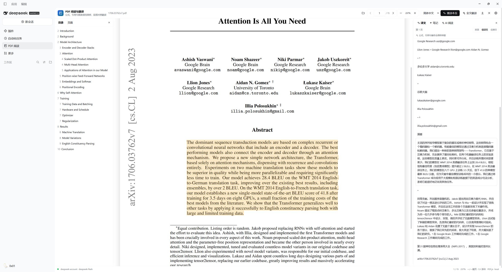
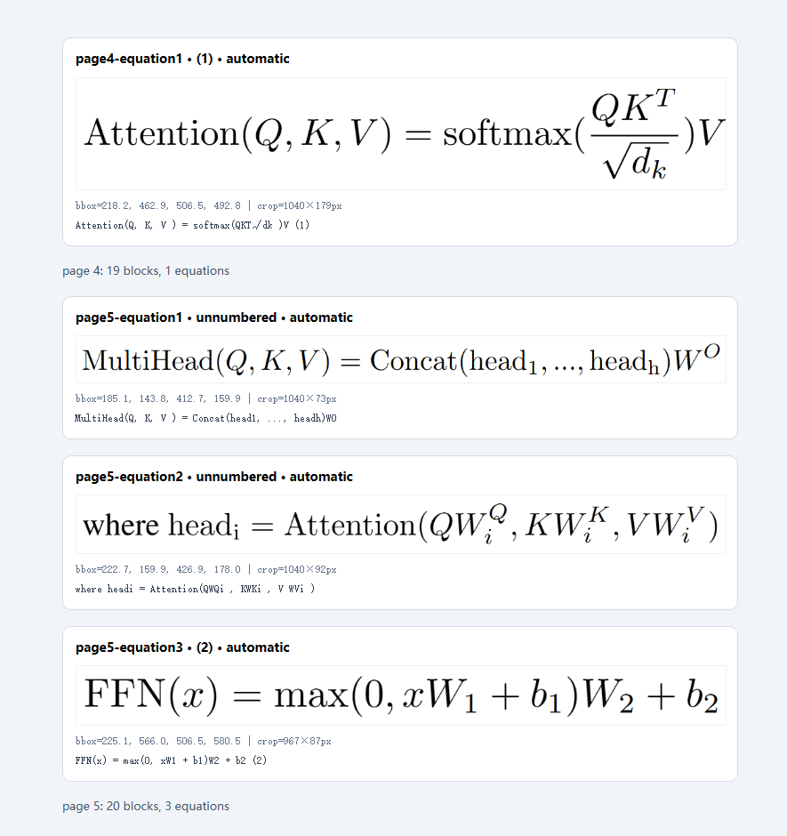
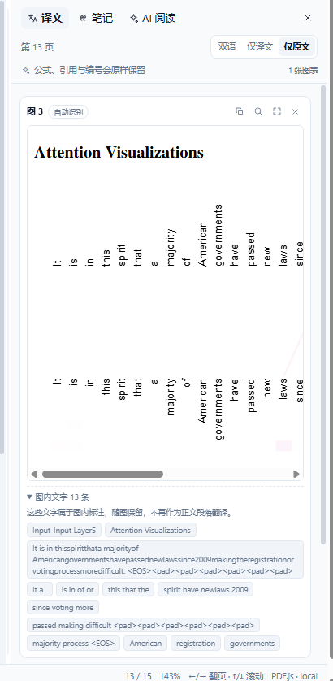

<p align="center">
  
</p>

<h1 align="center">dsh-pdf-math-reader</h1>

> PDF Math Reader — an academic PDF workspace for reading, translation, notes and AI Q&A inside DeepSeek Harness.

[](LICENSE)
[](assets/PDFJS-LICENSE)
[](https://github.com/deepseek-ai/deepseek-harness)
[](https://github.com/xiayifan1024/dsh-pdf-math-reader)

**English** | [简体中文](README.md)

**dsh-pdf-math-reader** (shown as **PDF Math Reader** in the UI) is a PDF reading and academic
translation plugin for the [DeepSeek Harness](https://github.com/deepseek-ai/deepseek-harness) Web
UI. Its design follows the
[PDFMathTranslate](https://github.com/PDFMathTranslate/PDFMathTranslate) principle of preserving
equations, citations and layout semantics, but implements it as **local reading with
paragraph-level bilingual alignment**, without modifying the original PDF.

It is meant for papers, technical reports, textbooks and any PDF with a text layer: the PDF is
rendered in the browser, and translation, glossary, reading notes and document Q&A all live in the
same panel.

<p align="center">
  
</p>

## Contents

- [Features](#features)
- [Quick start](#quick-start)
- [Keyboard shortcuts](#keyboard-shortcuts)
- [Configuration](#configuration)
- [Privacy and security](#privacy-and-security)
- [Architecture](#architecture)
- [Development](#development)
- [Limitations and roadmap](#limitations-and-roadmap)
- [FAQ](#faq)
- [Acknowledgements](#acknowledgements)
- [Contributing](#contributing)
- [License](#license)

## Features

### Reading

- A "PDF reader" sidebar entry, with outline navigation and real page thumbnails.
- PDFs are rendered locally, with paging, zoom, fit-to-width and two-column text reconstruction.
- Side panels are resizable by dragging the splitters; widths are saved automatically.
- The text layer uses PDF.js's native `TextLayer`, so selections line up with the page text.
- The first page is recomposed as article structure: a split title becomes one title block, authors,
  affiliations and e-mails form a compact author list, and the abstract and keywords get their own
  labels. Long abstracts are grouped at complete sentence boundaries.
- The `A−` / `A+` control at the top of the translation panel adjusts reading text size; text size
  and display mode are remembered.
- Source text, translations and author information can be selected and copied directly. Paragraphs,
  titles and abstracts also expose a hover copy button, and the toolbar can copy the whole page's
  source or translation. AI answers and reading notes have their own copy buttons.
- When the document has a reference section, the left rail shows a **References** tab: it detects
  References / Bibliography headings, splits numbered entries, and handles two-column and hanging
  indent layouts. The list is read-only, with selectable text and a copy-all action.
- The **Search** tab in the left rail searches the whole document. Multiple keywords are separated
  by spaces and must all appear; results are grouped by page with matching snippets. Clicking a
  result jumps to its page, highlights every hit on that page in blue and the selected hit in
  amber. The toolbar search button and `Ctrl` / `Cmd` + `F` open it directly; when the window is
  narrow and the rail is hidden, search appears as a floating panel.
- Reading position is stored per document fingerprint: reopening the same PDF, even after a page
  reload, returns to the page you last read. Settings offers **Clear reading positions**.
- `←` / `→` turn pages and `↑` / `↓` scroll the current page; `A` / `D` also turn pages.
- The mouse wheel scrolls within a page; scrolling past the top or bottom turns to the previous or
  next page (with a 1-second cooldown).

### Translation

- Paragraph-level **bilingual / translation only / original only** views, with a prominent
  segmented switch at the top of the translation panel that remembers the last choice.
- Bilingual mode pairs each source paragraph with its translation; translation-only mode uses a
  continuous article layout without per-paragraph card borders.
- The translation and AI-reading panels each have their own **model / reasoning effort** picker, so
  translation and Q&A can use different models. Choices are persisted locally; leaving the picker on
  default follows the current DSH default model.
- Translate the current page, a text selection or the whole document, with progress and a stop
  button.
- The translation prompt requires equations, LaTeX, citations, DOIs, numbering, code and URLs to be
  kept verbatim.
- Glossary: one `source=target` or `source:target` entry per line; matched terms are forced to the
  given translation.
- Translations are cached per paragraph, so revisiting a page does not re-request them; the cache
  can be cleared in settings.
- The target language and glossary are stored in the browser's `localStorage`.

### Equations

- Display equations are detected as **regions**, using equation numbers, right alignment, math
  fonts, operators, sub/superscripts and vertical whitespace. Headings, page numbers, list numbers
  and table cells are not treated as equations.
- Each equation is shown as one complete block: a high-resolution crop of the PDF region plus its
  number, instead of splitting limits and fractions into several fragment cards.
- Text items inside an equation region are removed from the body paragraphs; in bilingual mode the
  equation is shown once, while the paragraphs before and after it keep both original and
  translation.
- Clicking an equation block locates and highlights the source region; long equations scroll
  horizontally and can be viewed enlarged.
- When automatic detection is wrong, use **Select equation** in the toolbar to draw a box around the
  full region, or choose **Not an equation** on the card to undo a false positive. Corrections are
  persisted per **document fingerprint + page number** and stay in effect after reopening the
  document; automatic detection can also be restored per page.
- Inline math is replaced with unique `⟦MATH_001⟧` placeholders in translation requests; the
  returned translation must contain each placeholder exactly once, with no unknown markers. A failed
  check marks that paragraph as failed and offers a retry instead of storing a wrong translation.
- Each equation block reserves a `latex` field. Phase 2 will render it with KaTeX alongside the
  original image; if recognition or rendering fails, the image is shown instead.

<p align="center">
  
</p>

The image above is the actual crop produced from `tests/fixtures/attention.pdf`: the fraction and
the `T` and `d_k` scripts in equation (1) are not clipped, the scripts in equation (2) are complete,
and the equation number is shown separately in the card title.

### Figures and tables

- Figures and tables are classified separately. Figures come from the page's **drawing
  operations** (raster images and dense vector paths); tables also use the "Table N" caption,
  rules, column alignment and row spacing. Booktabs tables (rules only), captioned coloured
  headers (fill only) and **text-only tables** all become a "Table N" card instead of a
  header-only crop.
- A table crop grows over its data rows, keeping header, row labels and data together. Table
  captions and notes stay translatable body paragraphs.
- In-figure text is attributed by **visual row**: a row whose text mostly falls inside the artwork
  (or sits right above/below it as a panel title) becomes one of that figure's labels. Captions
  (`Figure 1:` / `Fig. 1` / `Table 2:`) never become labels.
- Figure labels no longer become body paragraphs, and annotation rows such as `Input → Output` are
  no longer detected as display equations.
- Each figure is one card: a high-resolution crop, its figure/table number and a collapsed list of
  its labels, so labels do not pile up in the translation pane.
- Clicking the card or the label area on the page locates and highlights the artwork; long figures
  scroll horizontally.
- **Zoom** is now a full-window viewer: a fresh high-resolution crop, 90° rotation both ways,
  zoom, drag-to-pan, **Fit whole / Fit width** and reset. Its rotation is local to the viewer and
  never changes the page's reading direction; closing returns to the same reading position.
- The toolbar's **Select figure** draws a complete figure/table region (auto-scrolling at the
  window edge, snapping to text-line edges). **Adjust bounds** on a card provides eight handles;
  saving updates the card, the viewer and exported images.
- A false positive can be dismissed with **Not a figure**, returning its text to the body flow.
  Manual regions and bounds persist per **document fingerprint + page number**. Each correction can
  be restored individually, and the whole page can be reset to auto-detection.

<p align="center">
  
</p>

The image above is the real sidebar for page 13 of `tests/fixtures/attention.pdf`: the heat map and
the text along its lines are collected into one "Figure 3" card, the labels are collapsed by default,
and the caption remains a normal translatable paragraph.

### Notes

- Click a PDF paragraph, switch to the **Notes** tab on the right and start writing.
- Notes appear as tagged cards: page number, source excerpt and note text.
- Clicking a note card jumps to its page and locates the paragraph; clicking the paragraph again
  clears the highlight.
- Paragraphs with notes are highlighted in yellow on the page; the selected paragraph is
  highlighted in orange.
- Notes are stored in the local `localStorage`, keyed by document fingerprint, and can be edited or
  deleted.
- **Save all notes to a file** writes a Markdown file through the Host. The target directory is
  configurable and defaults to `pdf-reader-notes` under the DSH working directory; an existing file
  name gets a timestamp suffix instead of being overwritten.

### AI reading

- An **AI reading** tab on the right supports multi-turn Q&A.
- Context scope is selectable: **This + adjacent pages** or **Whole document**.
- Answers are grounded in the supplied document text; the model is not expected to "remember" a
  whole PDF.
- A **DSH Skill** can be imported, as can a custom reading method from a local `.md` / `.txt` file.
- Useful questions include: the core contribution, what an equation means, experimental conclusions,
  and how the method differs from the baselines.

### Export

- Export bilingual Markdown; display equations are kept as numbered equation text blocks, and
  figures as a figure number plus their label list.
- Export **Markdown + equation/figure images ZIP**: the archive contains the `.md` file,
  `equations/*.png` and `figures/*.png`, so equations and figures remain visible when opened offline.
- Export printable comparison HTML; equation and figure images are embedded as data URIs, with no
  external files. The page can be printed to PDF directly from the browser.

## Quick start

### Requirements

- DeepSeek Harness Desktop / Web UI, with a working model route in the current profile.
- Node.js 22+ and npm to build the client.
- No Python, BabelDOC or extra PDF tooling at runtime.

### Installing in DSH

`--profile` is the profile you actually boot. A profile name is a directory under
`~/.dsh/profiles/` (`%USERPROFILE%\.dsh\profiles\` on Windows):

| How you start DSH | What `--profile` takes |
|---|---|
| DSH Desktop app | `desktop` |
| `dsh web` on the command line | `web` |
| Keeping the reader separate from your daily setup | any name, e.g. `reader`, then start with `dsh --profile reader web` |

The plugin only loads in the profile it was installed into: installed into `web`, it will not appear
in the desktop app, and vice versa. The name in the command must match the name you start DSH with.
If you are unsure which profiles exist, list that directory.

Installing directly from GitHub is recommended:

```bash
dsh plugin --profile desktop add github:xiayifan1024/dsh-pdf-math-reader
```

You can also clone the repository and install the local bundle (the in-app Plugin Manager acts on the
running profile, so there is no profile name to pass):

```text
plugin_manager install_bundle target=<absolute path to this repository>
```

For example:

```text
plugin_manager install_bundle target=D:\plugins\dsh-pdf-math-reader
```

After installation a "PDF reader" icon appears in the sidebar. If the Web UI was already open,
refresh the page (`Ctrl+Shift+R`) to load the new client bundle.

When the panel is opened for the first time, the plugin requests:

```text
GET /pdf-reader/api/health
```

to confirm the model service, provider, model and request limits.

### Updating

How you update depends on how the plugin was installed: a `github:` source pins an exact commit in
the lockfile, so a plain `pnpm install` never re-resolves it; a `link:` source points at a local
directory and has no version to resolve.

**Installed from GitHub** — re-resolve the dependency in the same profile:

```bash
dsh plugin --profile desktop update dsh-pdf-math-reader
```

You can also reinstall with an explicit tag (changing the tag is also how you roll back):

```bash
dsh plugin --profile desktop add github:xiayifan1024/dsh-pdf-math-reader#v1.5.0
```

Do not rely on `dsh plugin --profile desktop install` alone: when the specifier is unchanged, pnpm
answers `Lockfile is up to date`, the locked commit stays put, and the old code keeps loading.

**Installed from a local directory (`link:`)** — rebuild, no reinstall needed:

```bash
npm run build
```

**Installed with the in-app Plugin Manager** — follow its own advice for third-party plugins and
reinstall: `remove_bundle`, then `install_bundle` with the same target (the manager offers in-place
Update only for Official entries). `list_bundles` shows which version is installed.

Confirm the update took effect:

- Host-half changes (`index.js`, `lib/`) need a **DSH restart**; `client.js`-only changes need a hard
  refresh (`Ctrl+Shift+R`).
- `GET /pdf-reader/api/health` returns the `version` the Host half is running.
- To prove the GitHub source really moved, check the `codeload.github.com/…/tar.gz/<commit>` commit
  in `~/.dsh/profiles/<profile>/pnpm-lock.yaml`.

Uninstall with `dsh plugin --profile desktop remove dsh-pdf-math-reader`, which drops the dependency
and the `dsh.profile.bundles` entry together, or use `remove_bundle` in the Plugin Manager.

### Usage

1. Click **PDF reader** in the sidebar.
2. Click **Open PDF**, or drag a PDF into the panel.
3. Check the equation blocks in the translation panel; if detection is wrong, use **Select
   equation** to correct it, or **Not an equation** on a card to undo a false positive.
4. In **Translation** on the right, translate the current page, the selection or the whole document.
5. Click a paragraph, then switch to **Notes** to record the key points.
6. Switch to **AI reading**, choose a context scope and ask questions; import a Skill if needed.
7. Export bilingual Markdown, a Markdown + equation images ZIP, or comparison HTML from the top
   right.

## Keyboard shortcuts

| Action | Shortcut |
|---|---|
| Previous / next page | `←` / `→`, or `A` / `D` |
| Scroll the current page up / down | `↑` / `↓` |
| Open document search | `Ctrl` / `Cmd` + `F` |
| Wheel paging | Keep scrolling after reaching the top / bottom; 1-second cooldown |
| Clear paragraph highlight, selection and equation box | `Esc` |
| Typing in an input field | Does not trigger the shortcuts above |

## Configuration

Configuration lives in `cordis.patch.yml` and can also be overridden in the profile's patch layer:

```yaml
config:
  provider: deepseek-account   # leave empty to use the profile default
  model: deepseek-flash
  maxSegmentsPerRequest: 5
  maxCharsPerRequest: 3800
  maxTextChars: 8000
  timeoutMs: 180000
  cacheEntries: 600
  chatMaxChars: 24000
  chatTimeoutMs: 150000
  chatMaxTokens: 8192
```

| Field | Default | Description |
|---|---:|---|
| `provider` | profile default | Overrides the model provider |
| `model` | profile default | Overrides the model id |
| `maxSegmentsPerRequest` | `5` | Maximum paragraphs per translation request |
| `maxCharsPerRequest` | `3800` | Maximum characters per translation request |
| `maxTextChars` | `8000` | Maximum characters in a single paragraph |
| `timeoutMs` | `180000` | Translation request timeout (ms) |
| `cacheEntries` | `600` | Number of translation results kept in memory |
| `chatMaxChars` | `24000` | Maximum AI reading context characters |
| `chatTimeoutMs` | `150000` | Minimum wait for an AI reading answer; grows with the output budget (15-minute ceiling) |
| `chatMaxTokens` | `8192` | Default output tokens when an AI reading request has no valid answer-length selection; readers can choose 2048–65536 in settings, including values above this configuration |

`maxSegmentsPerRequest` and `maxCharsPerRequest` are lowered by the bundled `cordis.patch.yml`;
without that patch the code fallbacks are `6` and `4200`.

## Privacy and security

- **PDFs are never uploaded**: files are read and rendered in the browser, and only the text you
  explicitly translate or ask about is sent to the model.
- **Your existing model is used**: the plugin stores no API key; translation and chat go through the
  model route of the current DSH profile.
- **Resource isolation**: PDF.js, CMaps and fonts are all served by this plugin's Host, and asset
  paths are containment-checked, rejecting drive-letter paths, absolute paths and directory
  traversal.
- **Prompt constraints**: document paragraphs are passed as data, the model is asked to preserve
  equations and citations, and AI answers are restricted to the supplied excerpts.
- **Local data**: the glossary, notes, panel widths, reading positions and equation corrections live
  in the browser's `localStorage`; the translation cache exists only for the current page session.
  Saving notes to a file writes a local Markdown file through the Host and never uploads it.

## Architecture

```text
┌─────────────────────────────────────┐
│ Web UI (React, client.js)           │
│  PDF.js · TextLayer · notes         │
└───────────────┬─────────────────────┘
                │ same-origin HTTP
┌───────────────▼─────────────────────┐
│ DSH Host (index.js)                 │
│  static assets · translation ·      │
│  chat · skills                      │
└───────────────┬─────────────────────┘
                │ ctx.llm
┌───────────────▼─────────────────────┐
│ model route of the current profile  │
└─────────────────────────────────────┘
```

Host routes:

| Method | Path | Purpose |
|---|---|---|
| `GET` | `/pdf-reader/api/health` | Model and limit information |
| `POST` | `/pdf-reader/api/translate` | Batch paragraph translation |
| `POST` | `/pdf-reader/api/chat` | AI document Q&A |
| `GET` | `/pdf-reader/api/skills` | List available DSH skills |
| `POST` | `/pdf-reader/api/skill` | Read a skill's content |
| `POST` | `/pdf-reader/api/save-notes` | Write all notes to a Markdown file |
| `GET` | `/pdf-reader/assets/*` | PDF.js runtime assets |

Implementation notes:

- A PDF page is rendered to a canvas first, then its text is extracted separately; a failing text
  layer does not block reading.
- Text reconstruction preserves PDF content-stream order and handles column changes, vertical jumps
  back up the page, paragraph indentation and line spacing.
- Equation regions are detected and merged with sub/superscripts, limits, fractions and numbers
  before the remaining text is reconstructed into paragraphs. The page model emits `blocks`
  (`paragraph` / `equation` / `figure`) in reading order, and body paragraphs are derived from
  `blocks`, so older call sites (translation, notes, AI context) keep working.
- Figure regions come from the page operator list: image XObjects are mapped through the CTM, vector
  paths are clustered by proximity, then filtered by area, two-dimensional path count, fill and the
  share of table rules. Clustering sweeps boxes sorted by y and compares only row bands that can
  still intersect, so a heat map with a thousand cells finishes in tens of milliseconds.
- In-figure text is attributed before equation detection. Visual rows are counted inside the
  artwork, and a row that mostly falls inside belongs to the figure; caption rows are excluded and
  stay in the body flow. Attributed text is neither an equation candidate nor a paragraph.
- Figure `bbox` values also use scale-1 page coordinates, with a separate crop rect and a figure
  number taken from the nearest caption. Detected regions are cached per document and page, so zoom
  and sidebar resizing do not re-parse the operator list; a cached page model skips detection entirely.
- Equation `bbox` values are stored in scale-1 PDF page coordinates; highlighting and cropping
  convert through the viewport, so they stay consistent across zoom, sidebar resizing and reopening
  the document.
- Equation images are rendered on a dedicated canvas at display size × DPR under a maximum pixel
  budget. Cache keys include the document, page, crop rect and render resolution; a manual correction
  invalidates the matching cache.
- Inline math is isolated with `⟦MATH_xxx⟧` placeholders, and the Host validates every returned
  translation for completeness, duplicates and unknown markers.
- PDF.js may put a whole sentence and a trailing operator in the same text item. Extraction splits
  such items by math token ranges and replaces only the math fragment with a placeholder, instead of
  hiding the sentence. Equation-span expansion excludes stop words such as `of / is / a / the`; only
  variable-shaped short tokens (single letters, Greek letters, tokens containing digits or
  underscores, uppercase abbreviations, or known function names) are merged into the equation.
- Changing an equation region increments the translation epoch, cancels in-flight translations and
  clears loading state, so an old request cannot write results back under pre-rebuild paragraph ids.
- Each document owns its page caches (`src/cache.js`): page model, text items, figure regions and page
  rasters each have their own bound, and the viewer, translation, chat and export read one canonical
  model per page. Models are built at scale 1, so zoom and sidebar resizing repaint without re-parsing;
  line, equation and figure boxes are multiplied by the current scale only when drawn. Bounds are 12
  models, 12 text entries, 3 rasters plus a 48 MB byte budget, evicted least-recently-used, with
  `ImageBitmap.close()` on raster eviction; a raster that alone exceeds the budget stays on screen but
  is never stored, and it does not clear the pages already cached. A correction invalidates only that
  page's model and crops;
  its text items, raw figure detection and raster are reused. Async work from a previously opened
  document cannot write into the new one.
- Revisiting a page no longer re-rasterizes it: the render task *starts* a snapshot inside the same canvas
  queue but does not wait for it, so the page becomes ready and the next page may start drawing while the
  copy finishes; the snapshot is written to the cache afterwards, and re-entered pages are drawn with
  `drawImage`. When zoom or pixel ratio changed, the old snapshot is shown as a preview first, then an
  offscreen render replaces it in a single blit, so the page never flashes white. A cached model swaps the
  reading column immediately, while the canvas only leaves its loading state once the target page's pixels
  are actually on screen; highlights follow that state, so fast paging cannot draw the new page's boxes
  over the old raster.
- While reading, the next page is prefetched: once the current page's model is ready and the browser is
  idle, the following page is rendered into a detached canvas and snapshotted, and the page after that
  only gets its model built. If the target pixels would exceed the raster budget, or the browser cannot
  produce a snapshot, only the model is prefetched — the page is never drawn once for a cache that would
  reject it. When the raster budget is short, the **next page wins**: older pages are evicted, so going
  back several pages may re-render. A snapshot that resolves after the reader has moved away is dropped
  rather than evicting the page they are about to read. A page turn, a document change or a
  whole-document translation cancels the read-ahead; its failures are logged and never affect the
  visible page, and its entries obey the same bounds and least-recently-used eviction as everything else.
- Opening a file carries a task id; consecutive opens destroy stale tasks so an old file cannot
  overwrite a new one.
- Translation and chat requests are bound to client-disconnect signals; stopping cancels model
  generation on the Host.
- Switching the target language aborts old requests and increments the epoch; stale results are not
  applied to the new language.

Equation block in the page model:

```js
{
  id: 'page6-equation1',
  type: 'equation',
  pageIndex: 5,
  bbox: [x0, y0, x1, y1],        // scale-1 PDF page coordinates, including number and padding
  imageBbox: [x0, y0, x1, y1],   // crop rect, excluding the number padding on the right
  equationNumber: '(1)',
  sourceItemIds: [],             // PDF.js text item indexes, for traceability
  latex: null,                   // filled in by phase 2
  detectionSource: 'automatic'   // or 'manual'
}
```

`blocks` mixes `paragraph` and `equation` entries in reading order; `paragraphs` is derived from
`blocks`, so translation, notes and export can still work on body paragraphs only.

Figure block in the page model:

```js
{
  id: 'page13-figure1',
  type: 'figure',
  pageIndex: 12,
  bbox: [x0, y0, x1, y1],        // artwork plus its labels
  imageBbox: [x0, y0, x1, y1],   // crop rect (the artwork)
  figureNumber: '3',             // nearest caption number, or null
  caption: 'Figure 3: ...',      // caption text; it also stays a paragraph
  labels: [{ text, bbox }],      // in-figure text, grouped into visual rows
  labelCount: 13,
  text: '...',                   // label text for AI context and export
  detectionSource: 'automatic'
}
```

Figure labels are not translated; `text` and `labels` are used for display, locating and export.

## Development

```bash
npm install
npm run build
npm test
```

`client.js` is generated from `src/` and should not be edited directly. The build uses esbuild, with
React and the JSX runtime provided by the DSH browser module table.

```text
index.js                 Host entry: routes, model calls, skills, security checks
lib/                     Host pure functions with standalone tests (translation, chat, placeholder validation)
src/plugin.jsx           Main panel, reader, equation blocks, notes and AI reading UI
src/pdf.js               PDF.js loading, text reconstruction, equation crops, thumbnails, outline
src/equations.js         Equation region detection, bbox/crop sizing, manual correction merging
src/figures.js           Figure region detection (images/vector paths), label attribution, captions
src/references.js        Reference-section lookup, numbered entry splitting and continuation joining
src/search.js            Full-text keyword matching, snippets and hit-rectangle mapping
src/reading-position.js  Per-document last-read-page storage and restoration
src/zip.js               Dependency-free ZIP (store) writer
src/api.js               Same-origin HTTP API client
src/locales.js           Chinese and English UI strings
src/styles.js            Styles built on --dsw-alias-* theme tokens
assets/                  PDF.js 4.10.38, CMaps, standard fonts (Apache-2.0)
tests/                   node:test unit tests and a fixed PDF regression fixture
tests/fixtures/          attention.pdf (Attention Is All You Need)
scripts/                 Build and Node-side smoke tests
client.js                Built artifact
```

Test coverage:

- `node:test` unit tests for pure functions: strict translation JSON parsing, glossary, batch
  splitting, chat history and prompts.
- Placeholder validation: complete, duplicated and unknown markers, empty-output fallback and
  failure marking.
- Article structure: title, eight authors with affiliations/e-mails and the abstract boundary on the
  Attention first page; same-size title lines merged; long abstracts grouped by whole sentences
  without splitting decimal points.
- Equation detection: equations (1)/(2) in the real Attention PDF, fraction and script merging, table
  false positives, and zoom-invariant coordinates.
- Figure detection: image and vector regions, exclusion of table rules, icons and full-page scans,
  row-level label attribution, captions staying in the flow, arrow annotations staying out of the
  equation list, and **Not a figure** restoring the text.
- Manual correction: deleting an automatic equation, re-boxing a region and restoring the original
  text items.
- Equation crop sizing: DPR, maximum pixel budget and the long-edge limit.
- Central directory and local blocks of the Markdown + images ZIP.
- Host routes, strict translation JSON parsing, skill loading, asset path traversal and
  client-disconnect cancellation.
- Model catalog and selection: `/api/models` returns models and reasoning efforts; translation and
  chat requests can select a route and effort, with explicit 400 errors for unknown models/efforts.
- References: locating the References section in the real Attention PDF, splitting its 40 numbered
  entries, joining cross-paragraph continuations, reading the left column before the right,
  repeated headers, author-year lists, and showing the rail tab only when present.
- Keyword search: all-keyword AND matching, phrase preference, case insensitivity, complete words
  across line-end hyphenation and compound-word hyphens, every-hit highlighting, snippets, wrapped
  hit rectangles and RTL fragment spacing; reading positions: per-fingerprint isolation, out-of-range
  rejection and ageing out old records.
- Client module-loader wrapper and slot registration.
- Joining adjacent text fragments and two-column paragraph boundaries.

### Equation regression fixture

The fixed fixture is `tests/fixtures/attention.pdf` (*Attention Is All You Need*, 15 pages). Current
heuristic detection results over the whole fixture:

| Page | Page content | Detection result |
|---:|---|---|
| 4 | Equation (1) `Attention(Q,K,V)` | 1 complete equation block, with number |
| 5 | `MultiHead`, `where head_i`, equation (2) `FFN` | 3 equation blocks (the first two are unnumbered) |
| 6 | The two positional-encoding equations | 2 equation blocks; table 1 is not misdetected |
| 7 | Learning-rate equation (3) | 1 complete equation block |
| 8 | Numbers and `·` in tables 2/3 | 0 equation blocks (tables are not misdetected) |
| Other pages | Title, body, references | 0 equation blocks |

The regression suite covers the full bbox of equations (1)/(2), fragments staying out of body
paragraphs, correct numbers, unchanged bbox after zooming, no table false positives, and manual
boxing / undoing / restoring. These numbers apply to this one sample only; coverage must be
re-evaluated when extending to other papers. The fixture is from Vaswani et al., *Attention Is All
You Need* ([arXiv:1706.03762](https://arxiv.org/abs/1706.03762)) and is used only for text extraction
and equation-region regression tests.

### Figure regression fixture

Figure detection on the same sample:

| Page | Page content | Detection result |
|---:|---|---|
| 3 | Transformer architecture (one full raster image) | 1 figure, number 1, 0 labels (its text is rasterised) |
| 4 | Scaled Dot-Product / Multi-Head Attention diagrams | 2 figures, both numbered 2; each panel title is a label |
| 6 | Table 1 (text-only, no artwork) | 1 "Table 1" card; header and data rows are cropped together, the caption stays translatable |
| 8 | Table 2 (text-only, spans two columns) | 1 "Table 2" card with 13 table strings; the caption stays translatable |
| 13 | Attention-visualisation heat map (vector artwork with text along lines) | 1 figure, number 3, 13 label rows; the caption stays a translatable paragraph |
| 14 / 15 | Two attention-head visualisations | 1 figure each, numbers 4 / 5, 21 label rows each |

The regression suite covers figure bboxes, figure/table numbers, caption retention, labels staying
out of body paragraphs, arrow annotations staying out of the equation list, table growth, manual
selection/replacement, and **Not a figure** returning the text to the body flow. Thresholds were
calibrated on this sample and synthetic cases; unusual layouts may still need manual correction.

## Limitations and roadmap

- This is a **paragraph-aligned view inside the reader**; it does not produce a reflowed monolingual
  or bilingual PDF. The comparison HTML can be printed to PDF from the browser.
- Phase 1 of equation support is "region detection + high-resolution crop + placeholder protection".
  The `latex` field is reserved for phase 2; no equation recognition service is connected yet, and
  KaTeX rendering is not implemented.
- The boundary between inline math and body text, including baselines and line breaks, is the next
  task; display equations and placeholder validation are prioritised for now.
- Automatic detection is heuristic and needs evaluation on more papers. Manual correction is
  available through **Select equation**, **Select figure**, **Adjust bounds**, **Not an equation**,
  **Not a figure** and **Restore auto-detection**.
- Table detection handles coloured headers, rule-based tables, grids and text-only tables;
  continued tables across pages are cropped per page and not merged yet.
- Figure labels and table cells are kept as reference text and are not translated; figure and table
  captions are translated as body paragraphs.
- Scanned PDFs without a text layer are not OCR'd; the page reports that no text was found, and a
  table can still be captured with **Select figure**.
- Page-level rotation is not implemented yet; this release provides rotation inside the viewer only.
  Two-column and multi-column layouts use heuristic reconstruction; unusual layouts may need manual
  paragraph-boundary fixes.
- AI conversations live in the current document session and reset when the document changes; notes,
  glossary and equation corrections persist in browser storage.
- Roadmap: equation recognition service + KaTeX, BabelDOC bilingual PDF, OCR, cross-session note
  sync, multi-document bookshelf.

## FAQ

**The "PDF reader" icon is missing after installation.**  
Refresh the Web UI or reopen the panel, and confirm that `plugin_manager install_bundle` returned
`application: applied`. Also confirm the plugin went into the profile you actually boot
(see [Installing in DSH](#installing-in-dsh)).

**"Rendering page…" appears while paging.**  
That is a normal page-rendering indicator, not a model request. The model is only called for
translation, AI Q&A and the health check when the panel opens.

**The model is unavailable / translation fails.**  
Check `llm`, `provider` and `model` in the `/pdf-reader/api/health` response, make sure the current
profile has a signed-in model available, or override `provider` / `model` in the configuration.

**The AI reading answer is empty or cut off.**

The output budget covers thinking plus the answer: at a higher reasoning effort thinking can consume
all of it, so the 2048 / 4096 steps often return no text at all. Raise **Answer length limit** to
16384 or more, or lower the reasoning effort; the 65,536 step is meant for full-paper deep reads, and
the wait limit grows with the budget automatically.

**A scanned PDF has no text.**  
This version does not do OCR; the page reports that no text was found. OCR support is tracked on the
roadmap.

**Selection is misaligned with the text.**  
The plugin uses PDF.js's native `TextLayer`. A few PDFs with incomplete font metrics can still be
off by a little. Please report with a screenshot of the page and the PDF version.

## Acknowledgements

- [PDFMathTranslate / PDF2ZH](https://github.com/PDFMathTranslate/PDFMathTranslate): reference for
  academic PDF layout and translation philosophy.
- [PDF.js](https://github.com/mozilla/pdf.js): PDF rendering and the text layer.
- [DeepSeek Harness](https://github.com/deepseek-ai/deepseek-harness): plugin runtime and Web UI.

This project is not affiliated with the projects above; PDFMathTranslate's BabelDOC layout pipeline
is not included in this repository.

## Contributing

Issues and pull requests are welcome. Before submitting:

1. Run `npm test`.
2. If you changed anything under `src/`, run `npm run build` again and commit the generated
   `client.js`.
3. Describe the test environment, reproduction steps and screenshots (for UI changes) in the PR.
4. Do not commit personal PDFs, API keys, profile configuration or logs containing personal paths.

## License

The plugin code is released under the [MIT License](LICENSE). PDF.js is distributed under
Apache-2.0; see [assets/PDFJS-LICENSE](assets/PDFJS-LICENSE).
