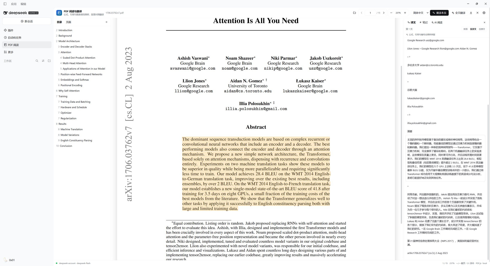

# dsh-pdf-math-reader

> PDF Math Reader — 在 DeepSeek Harness 中阅读、翻译、记笔记与 AI 问答一体化的学术 PDF 工作台。

[](LICENSE)
[](assets/PDFJS-LICENSE)
[](https://github.com/deepseek-ai/deepseek-harness)
[](https://github.com/xiayifan1024/dsh-pdf-math-reader)

**dsh-pdf-math-reader**（界面名称：PDF Math Reader）是一个运行在
[DeepSeek Harness](https://github.com/deepseek-ai/deepseek-harness) Web UI 中的 PDF
阅读与学术翻译插件。设计参考
[PDFMathTranslate](https://github.com/PDFMathTranslate/PDFMathTranslate)
“保持公式、引用与版式语义”的学术文档阅读思路，但以 **本地阅读 + 段落级双语对照**
的方式落地，不修改原 PDF。

它适合读论文、技术报告、教材和带文本层的 PDF：PDF 在浏览器内渲染，翻译、术语表、
阅读笔记、AI 文献问答都在同一个面板中完成。

<p align="center">
  
</p>

## 目录

- [功能](#功能)
- [快速开始](#快速开始)
- [快捷键](#快捷键)
- [配置](#配置)
- [隐私与安全](#隐私与安全)
- [架构](#架构)
- [开发](#开发)
- [限制与路线图](#限制与路线图)
- [常见问题](#常见问题)
- [致谢](#致谢)
- [贡献](#贡献)
- [License](#license)

## 功能

### 阅读

- 侧边栏「PDF 阅读」入口，目录与真实页面缩略图导航。
- 本地渲染 PDF，支持翻页、缩放、适合宽度、双栏文本重建。
- 左右侧栏可拖动分隔条调整宽度，宽度自动保存。
- 文本层使用 PDF.js 原生 `TextLayer`，选中范围与页面文字对齐。
- `←` / `→` 翻页，`↑` / `↓` 滚动当前页；`A` / `D` 也可以翻页。
- 鼠标滚轮在页面内滚动，到达顶部/底部后自动翻到上一页/下一页（1 秒冷却）。

### 翻译

- 段落级 **双语 / 仅译文 / 仅原文** 三种视图。
- 单页翻译、选中文本翻译、全文批量翻译，带进度与停止。
- 翻译提示词要求原样保留公式、LaTeX、引用、DOI、编号、代码与 URL。
- 术语表：每行 `source=target` 或 `source：target`，命中术语强制使用指定译名。
- 译文按段缓存，切换页面不重复请求；可在设置中清除缓存。
- 目标语言与术语表保存在浏览器 `localStorage`。

### 笔记

- 点击 PDF 段落，切到右侧「笔记」标签即可写笔记。
- 笔记以标签卡片展示：页码、原文摘录、笔记内容。
- 点击笔记卡片跳转到对应页并定位段落；再次点击段落可取消高亮。
- 有笔记的段落在页面上以黄色高亮显示，当前选中段落以橙色高亮显示。
- 笔记保存在本地 `localStorage`，按文档指纹区分，支持编辑与删除。

### AI 文献阅读

- 右侧「AI 阅读」标签，支持多轮问答。
- 上下文范围可选：**本页及相邻页** 或 **全文**。
- 回答只基于传入的文档文本，不要求模型“记住”整篇 PDF。
- 可导入 **DSH Skill**，或从本地 `.md` / `.txt` 文件导入自定义阅读方法。
- 适合问：核心贡献、公式含义、实验结论、方法与 baseline 的差异等。

### 导出

- 导出双语 Markdown。
- 导出可打印的对照 HTML；可直接用浏览器“打印为 PDF”。

## 快速开始

### 环境要求

- DeepSeek Harness Desktop / Web UI，且 profile 中已配置可用的模型路由。
- 构建客户端需要 Node.js 22+ 与 npm。
- 运行时不需要 Python、BabelDOC 或额外 PDF 工具。

### 安装到 DSH

推荐直接从 GitHub 安装：

```bash
dsh plugin --profile <你的 profile> add github:xiayifan1024/dsh-pdf-math-reader
```

也可以克隆仓库后使用本地 bundle：

```text
plugin_manager install_bundle target=<本仓库绝对路径>
```

例如：

```text
plugin_manager install_bundle target=D:\plugins\dsh-pdf-math-reader
```

安装成功后，侧边栏会出现「PDF 阅读」图标。若安装前 Web UI 已经打开，请刷新页面
（`Ctrl+Shift+R`）以加载新的客户端 bundle。

首次打开面板时，插件会请求：

```text
GET /pdf-reader/api/health
```

确认模型服务、provider、model 与请求限制。

### 使用流程

1. 点击侧边栏「PDF 阅读」。
2. 点击「打开 PDF」或把 PDF 拖进面板。
3. 在右侧「译文」中翻译当前页、选中文本或全文。
4. 点击段落 → 切到「笔记」记录要点。
5. 切到「AI 阅读」，选择上下文范围后提问；需要时导入 Skill。
6. 从右上角导出双语 Markdown 或对照 HTML。

## 快捷键

| 操作 | 快捷键 |
|---|---|
| 上一页 / 下一页 | `←` / `→`，或 `A` / `D` |
| 当前页向上 / 向下滚动 | `↑` / `↓` |
| 滚轮翻页 | 页面滚到顶部/底部后继续滚动，1 秒冷却 |
| 取消段落高亮与选区 | `Esc` |
| 输入框中输入 | 不会触发上述快捷键 |

## 配置

配置位于 `cordis.patch.yml`，也可以在 profile 的 patch 层覆盖：

```yaml
config:
  provider: deepseek-account   # 留空则使用 profile 默认模型
  model: deepseek-flash
  maxSegmentsPerRequest: 5
  maxCharsPerRequest: 3800
  maxTextChars: 8000
  timeoutMs: 180000
  cacheEntries: 600
  chatMaxChars: 24000
  chatTimeoutMs: 150000
  chatMaxTokens: 2048
```

| 字段 | 默认值 | 说明 |
|---|---:|---|
| `provider` | profile 默认 | 覆盖模型 provider |
| `model` | profile 默认 | 覆盖模型 id |
| `maxSegmentsPerRequest` | `5` | 单次翻译请求的最大段数 |
| `maxCharsPerRequest` | `3800` | 单次翻译请求的最大字符数 |
| `maxTextChars` | `8000` | 单个段落的最大字符数 |
| `timeoutMs` | `180000` | 翻译请求超时 |
| `cacheEntries` | `600` | 翻译结果内存缓存条数 |
| `chatMaxChars` | `24000` | AI 阅读上下文最大字符数 |
| `chatTimeoutMs` | `150000` | AI 阅读请求超时 |
| `chatMaxTokens` | `2048` | AI 阅读最大输出 token |

## 隐私与安全

- **PDF 不上传**：PDF 文件在浏览器内读取和渲染，只有你主动翻译或提问的文本会发送到模型。
- **使用现有模型**：插件不保存 API Key；翻译与问答走当前 DSH profile 的模型路由。
- **资源隔离**：PDF.js、CMaps、字体全部由本插件 Host 提供，资源路径经过包含性校验，拒绝盘符路径、绝对路径和目录穿越。
- **提示词约束**：文档段落作为数据传入，并要求模型保留公式与引用；AI 回答被限定在提供的文档片段内。
- **本地数据**：术语表、笔记与面板宽度保存在浏览器 `localStorage`；翻译缓存只存在当前页面会话内。

## 架构

```text
┌──────────────────────────────┐
│ Web UI（React，client.js）    │
│  PDF.js · TextLayer · 笔记    │
└──────────────┬───────────────┘
               │ 同源 HTTP
┌──────────────▼───────────────┐
│ DSH Host（index.js）          │
│  静态资源 · 翻译 · 问答 · Skill │
└──────────────┬───────────────┘
               │ ctx.llm
┌──────────────▼───────────────┐
│ 当前 profile 的模型路由        │
└──────────────────────────────┘
```

Host 路由：

| 方法 | 路径 | 用途 |
|---|---|---|
| `GET` | `/pdf-reader/api/health` | 模型与限制信息 |
| `POST` | `/pdf-reader/api/translate` | 批量段落翻译 |
| `POST` | `/pdf-reader/api/chat` | AI 文献问答 |
| `GET` | `/pdf-reader/api/skills` | 列出可用 DSH Skill |
| `POST` | `/pdf-reader/api/skill` | 读取 Skill 内容 |
| `GET` | `/pdf-reader/assets/*` | PDF.js 运行时资源 |

实现要点：

- PDF 页面先渲染 canvas，再单独提取文本，文本层失败不阻塞阅读。
- 文本重建保留 PDF 内容流顺序，并处理双栏换栏、纵向回跳、段落缩进与行间距。
- 每个文档拥有独立的页面模型缓存；切换文档后的旧异步任务不会写入新文档缓存。
- 打开文件带任务编号；连续打开时过期任务会被销毁，避免旧文件覆盖新文件。
- 翻译与问答请求绑定客户端断开信号，停止后会取消 Host 侧模型生成。
- 切换目标语言会中止旧请求并递增 epoch，旧结果不会回填到新语言状态。

## 开发

```bash
npm install
npm run build
npm test
```

`client.js` 由 `src/` 打包生成，不要直接编辑。构建使用 esbuild，React 与 JSX runtime
由 DSH 浏览器模块表提供。

```text
index.js                 Host 插件入口：路由、模型调用、Skill、安全校验
lib/                     可独立测试的 Host 纯函数（翻译/问答提示词与解析）
src/plugin.jsx           主面板、阅读器、笔记、AI 阅读交互
src/pdf.js               PDF.js 加载、文本重建、缩略图、目录
src/api.js               同源 HTTP API 客户端
src/locales.js           中英文界面文案
src/styles.js            使用 --dsw-alias-* 主题 token 的样式
assets/                  PDF.js 4.10.38、CMaps、标准字体（Apache-2.0）
tests/                   node:test 纯函数单测
scripts/                 构建与 Node 侧冒烟测试
client.js                构建产物
```

测试覆盖：

- `node:test` 纯函数单测：翻译 JSON 严格解析、术语表、批次切分、问答历史与提示词。
- Host 路由、翻译 JSON 严格解析、Skill 读取、资源路径越界、客户端断开取消。
- 客户端模块加载器包装与 Slot 注册。
- 相邻文本片段拼接、双栏段落边界。
- PDF.js 文本提取与真实模型调用需在安装后的 Harness 中手动验证。

## 限制与路线图

- 当前是**阅读器内的段落对照**，不生成重排后的单语/双语 PDF；对照 HTML 可通过浏览器打印为 PDF。
- 扫描版 PDF 没有文本层时不会自动 OCR；页面会提示无文本。
- 双栏/多栏布局使用启发式重建，极端排版可能需要人工调整段落边界。
- AI 对话保存在当前文档会话内，切换文档会重置；笔记与术语表持久化在浏览器本地。
- 路线图：接入 BabelDOC 生成双语 PDF、OCR、跨会话笔记同步、多文档书架。

## 常见问题

**安装后看不到「PDF 阅读」图标？**  
刷新 Web UI，或重新打开面板。确认 `plugin_manager install_bundle` 返回 `application: applied`。

**翻页时显示「正在渲染页面…」？**  
这是正常的页面渲染提示，不是模型请求。模型只在翻译、AI 问答和打开面板时的 health check 中调用。

**模型不可用 / 翻译失败？**  
检查 `/pdf-reader/api/health` 返回的 `llm`、`provider`、`model`；确认当前 profile 已登录可用模型，或在配置中覆盖 `provider` / `model`。

**扫描版 PDF 没有文本？**  
当前版本不做 OCR；页面会提示无文本。可在路线图中跟踪 OCR 支持。

**选中范围和文字对不齐？**  
插件使用 PDF.js 原生 TextLayer；极少数 PDF 的字体度量不完整时仍可能有偏差。请附上页面截图与 PDF 版本反馈。

## 致谢

- [PDFMathTranslate / PDF2ZH](https://github.com/PDFMathTranslate/PDFMathTranslate)：学术 PDF 布局与翻译理念参考。
- [PDF.js](https://github.com/mozilla/pdf.js)：PDF 渲染与文本层。
- [DeepSeek Harness](https://github.com/deepseek-ai/deepseek-harness)：插件运行时与 Web UI。

本项目与上述项目无隶属关系；PDFMathTranslate 的 BabelDOC 排版管线未包含在本仓库中。

## 贡献

欢迎提交 issue 和 pull request。提交前请：

1. 运行 `npm test`。
2. 如果修改了 `src/`，重新运行 `npm run build` 并提交生成的 `client.js`。
3. 在 PR 中说明测试环境、复现步骤和截图（涉及 UI 时）。
4. 不要提交个人 PDF、API Key、profile 配置或包含个人路径的日志。

## License

本插件代码采用 [MIT License](LICENSE)。PDF.js 以 Apache-2.0 分发，
许可证见 [assets/PDFJS-LICENSE](assets/PDFJS-LICENSE)。
